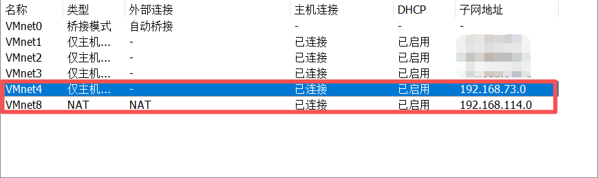

# 红日靶场 2 蒟蒻笔记

---

## 目录

>[!ERROR]
>
>remember to finish this after finish the whole note

---

## 环境配置
>[!CAUTION]
>
> **警告！**
>
> 为保证不发生不可预测的严重后果，请不要在真实的网络环境中进行此实验。请在虚拟机环境中完成本实验。推荐使用 [VMware Workstation Pro](https://vmware.xznkjzx.cn/)。

>[!IMPORTANT]
>
>1. 你需要下载 [红日靶场 2](http://vulnstack.qiyuanxuetang.net/vuln/detail/3/)
>2. 推荐使用 [kali](https://www.kali.org/) 作为攻击机。
>3. 建议在实验前，下载并安装好 这些软件

>[!ERROR]
>
>remember to add the specific apps after finish the attack

### 靶机配置

>[!ERROR]
>
>This part has been just copied to here, there are too many details I have not correct!

1. 通过扫描红日靶场 2 的本地存储目录添加虚拟机。
2. 编辑 $\rightarrow$ 虚拟网络编辑器 $\rightarrow$ 更改配置 $\rightarrow$ 配置网络如下（只用管 VMnet4 和 VMnet8）：

1. 依次编辑三台靶机设置，调整 ```网络适配器``` 为 ```自定义(VMnet3)```
2. 编辑 win7 靶机设置，添加 ```网络适配器 2``` 为 ```NAT``` 模式
3. 进入靶机 windows 2008 dc，密码为：```2020.com```，极大概率会让你重置密码，我们重置为 ```win2008.com```
4. 进入靶机 win7，密码为：```123.com```
5. 进入各靶机，打开 ```cmd``` 或 ```powershell```，运行指令 ```ipconfig``` 查看本机 ip 地址。应如下：

| 机器名称 | ip 地址（VMnet3） |
|:-:|:-:|
| windows 2008 | 192.168.138.138 |
| win7 | 192.168.138.136 |

8. 为方便后续操作进行，现展示本蒟蒻的 ```NAT``` 模式下的 kali 和 win7 的 ip 地址，在笔记用到下面 ip 地址时，请替换为自己对应虚拟机的 ip 地址。（在 kali 中，命令变为 ```ifconfig```）

| 机器名称 | ip 地址（NAT） |
|:-:|:-:|
| kali | 192.168.114.132 |
| win7 | 192.168.114.128 |

>[!TIP]
>
>当我们使用命令 ```ipconfig``` 确认检查各虚拟机 IP 地址时有概率发现 win7 的 “以太网适配器 wk1 waiwang” 网络连接，也就是理论上被我们设置为 NAT 模式的网卡一直在使用一个 ```192.168.135.150``` 的 IP 地址。
>
>
>
>我们需要使用 Win+R 快捷键并输入 ```ncpa.cpl``` 打开网络连接控制面板双击 “wk1 waiwang”，单击属性，输入管理员账号密码：```Administrator/dc123.com```
>
>
>
>双击 “Internet 协议版本4 (TCP/IPv4)属性”，改成 “自动获得 IP 地址” 与 “自动获得 DNS 服务器地址”，一路点击 “确定” 保存设置修改。
>
>

---

## 完成实验

至此，我们算是彻底完全攻陷了全域。

以图形式展示会话如下：

>[!ERROR]
>
>remember to add image

## 实验清理

我们可以选择将四台虚拟机恢复到实验前快照的状态，如果没有打快照，那建议直接将四台虚拟机全部扬了重装，以防历史数据影响实验。

---

## 参考文献
1. [ATT&CK实战系列：红日靶场 1（内网攻防实战）详细打靶思路](https://blog.csdn.net/2301_80007437/article/details/159826652)
2. [ATT&CK 红队靶场实战 - 红日靶场 1](https://blog.lololowe.com/posts/bb48/)
3. [获取蚁剑](https://www.yuque.com/antswordproject/antsword/srruro)
4. [Cobalt Strike 安装和基本使用方式](https://blog.lololowe.com/posts/7126/)